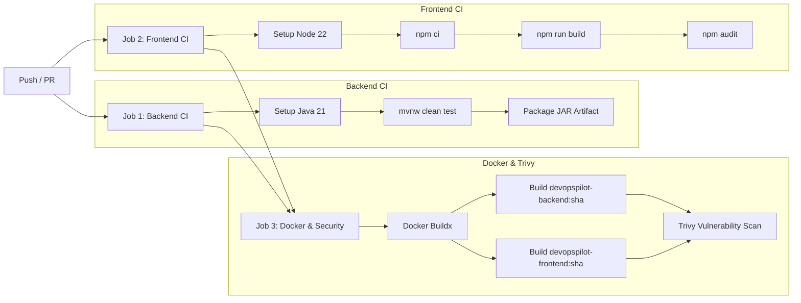

# DevOpsPilot 🚀
### End-to-End Automated Software Delivery & Infrastructure Management Platform

[](https://github.com/Srinithi-15/DevOpsPilot/actions/workflows/ci-cd.yml)
[](https://www.oracle.com/java/)
[](https://spring.io/projects/spring-boot)
[](https://react.dev/)
[](https://docs.docker.com/compose/)
[](https://prometheus.io/)
[](https://grafana.com/)
[](LICENSE)

---

## 📌 1. Project Overview & Problem Statement

### 🎯 The Problem
Learning enterprise-grade DevOps practices is often hindered by two major barriers:
1. **Steep Cloud Expenses**: Deploying real delivery pipelines on AWS, GCP, or Azure quickly accumulates monthly bills (EC2, NAT Gateways, RDS, Container Registries).
2. **Superficial / Mocked Tutorials**: Most student projects rely on fake data, simple `echo` scripts, or disconnected single containers, failing to demonstrate real database migrations, health verification, automated rollback, or live telemetry.

### 💡 The Solution: DevOpsPilot
**DevOpsPilot** is a production-grade, self-hosted software delivery and infrastructure management platform built entirely on a **₹0 budget**. It delivers real DevOps capabilities on local developer workstations and self-hosted environments:
- **Full-Stack Microservices Architecture**: Spring Boot 3 REST API + MySQL 8.0 relational persistence + modern React JSX (Vite + Tailwind CSS) operations dashboard.
- **Automated CI/CD Pipeline**: GitHub Actions workflow orchestrating automated Maven testing, Node bundling, Trivy container security scanning, and multi-stage Docker image builds.
- **Automated Deployment & Self-Healing Rollback**: Zero-downtime deployment scripts (`deploy.ps1` / `deploy.sh`) with Actuator health probes, automatic failure detection, and instant zero-data-loss rollback to `:previous` Docker images.
- **Real-Time Telemetry & Observability**: Micrometer-instrumented Spring Boot Actuator scraped by Prometheus (9090) and visualized on auto-provisioned Grafana (3000) dashboards.

---

## 🏗️ 2. System Architecture

```mermaid
flowchart TD
    subgraph CI_CD["GitHub Actions CI/CD (.github/workflows/ci-cd.yml)"]
        GIT["Git Push (main)"] --> JTEST["Backend Test & Flyway Validation (Java 21)"]
        GIT --> FE_LINT["Frontend Build & Audit (Node 22)"]
        JTEST & FE_LINT --> DOCKER_BUILD["Multi-Stage Docker Image Build"]
        DOCKER_BUILD --> TRIVY_SCAN["Trivy Vulnerability Scan (High/Crit)"]
    end

    subgraph ContainerStack["Docker Multi-Container Orchestration (docker-compose)"]
        subgraph WebLayer["Frontend Presentation & Reverse Proxy"]
            FE["devopspilot-frontend\n(Nginx Alpine :5173)"]
        end

        subgraph CoreBackend["Backend Application Engine"]
            BE["devopspilot-backend\n(Spring Boot 3 / Temurin 21 :8080)"]
            ACTUATOR["Spring Boot Actuator\n/actuator/health & /prometheus"]
        end

        subgraph Persistence["Relational Storage"]
            DB[("devopspilot-mysql\n(MySQL 8.0 :3307)")]
            DB_VOL[("Volume: devopspilot_mysql_data")]
            DB --- DB_VOL
        end

        subgraph Monitoring["Observability Stack"]
            PROM["devopspilot-prometheus\n(Prometheus v2.53 :9090)"]
            GRAF["devopspilot-grafana\n(Grafana v11.1 :3000)"]
            PROM_VOL[("Volume: prometheus_data")]
            PROM --- PROM_VOL
        end
    end

    FE -->|Proxy /api/*| BE
    FE -->|Proxy /actuator/*| ACTUATOR
    BE -->|HikariCP Connection Pool| DB
    PROM -->|Scrape metrics (15s interval)| ACTUATOR
    GRAF -->|PromQL Datasource| PROM
```

---

## 🛠️ 3. Technology Stack

| Layer | Technology | Version | Purpose in DevOpsPilot |
|---|---|---|---|
| **Frontend** | React JSX + Vite + Tailwind CSS | React 18, Vite 5 | Interactive operational dashboard, real-time health monitors, deployment logs |
| **Backend** | Java + Spring Boot | Java 21 LTS, Spring Boot 3.3.5 | Core REST API, deployment orchestrator, Flyway migrations, Actuator metrics |
| **Database** | MySQL Server | 8.0 | Persistent relational storage for service registry and immutable deployment audit trail |
| **Containerization** | Docker & Docker Compose | Compose v2 | Multi-container orchestration, isolated bridge networking, named volume persistence |
| **CI/CD** | GitHub Actions | Workflows v4 | Automated unit testing, security scanning, multi-stage image packaging |
| **Security Scanning**| Aqua Security Trivy | Latest | Automated vulnerability scanning for container images and OS packages |
| **Metrics Scraper** | Prometheus | v2.53.0 | Time-series scraper collecting real JVM, CPU, memory, and HTTP metrics |
| **Visualization** | Grafana | v11.1.0 | Real-time monitoring dashboards with automated zero-touch provisioning |
| **Automation** | PowerShell & Bash | PS 7 / Bash 5 | Automated deployment scripts with health check polling and automated rollback |

---

## 📁 4. Project Folder Structure

```text
DevOpsPilot/
├── .github/
│   └── workflows/
│       └── ci-cd.yml             # GitHub Actions CI/CD workflow definition
├── backend/                      # Spring Boot 3 + Java 21 REST API
│   ├── src/main/java/            # Controllers, Services, Entities, DTOs, Repositories
│   ├── src/main/resources/       # application.yml, db/migration/V1__initial_schema.sql
│   ├── src/test/                 # Unit & Integration test suites (H2 in-memory test profile)
│   ├── pom.xml                   # Maven dependencies (Temurin JDK 21)
│   ├── mvnw & mvnw.cmd           # Cross-platform Maven Wrappers
│   └── Dockerfile                # Multi-stage build (Temurin JDK 21 -> JRE 21 Alpine)
├── frontend/                     # React JSX + Vite Single Page Application
│   ├── src/                      # Dashboard, Services, Deployments, Observability pages
│   ├── package.json              # NPM dependencies (Lucide icons, Axios, Tailwind CSS)
│   ├── nginx.conf                # Production Nginx reverse proxy configuration
│   └── Dockerfile                # Multi-stage build (Node 22 Alpine -> Nginx Unprivileged)
├── devops/                       # Infrastructure as Code & Orchestration
│   ├── docker/
│   │   ├── docker-compose.yml    # Full stack definition (Frontend, Backend, DB, Monitoring)
│   │   └── .env.example          # Environment variable template
│   ├── monitoring/
│   │   ├── prometheus/           # Prometheus scrape configuration (prometheus.yml)
│   │   └── grafana/              # Dashboards & Datasource auto-provisioning
│   └── scripts/
│       ├── deploy.ps1 & deploy.sh     # Automated zero-downtime deployment scripts
│       └── rollback.ps1 & rollback.sh # Self-healing rollback scripts
├── docs/                         # Architecture documentation & portfolio guides
│   ├── architecture/overview.md  # Architectural specification
│   └── PORTFOLIO_INTERVIEW_GUIDE.md # Interview cheatsheet, technical challenges, resume bullets
├── .gitignore                    # Comprehensive ignores for Java, Node, Docker, and secrets
└── README.md                     # Flagship repository documentation
```

---

## ⚡ 5. Quick Start & Local Setup

### Prerequisites
- [Docker Desktop](https://www.docker.com/products/docker-desktop/) installed and running.
- [Java 21 LTS](https://adoptium.net/) (optional for local host builds; Docker handles container builds).
- [Node.js 22 LTS](https://nodejs.org/) (optional for local host builds).
- Git.

### 1. Clone Repository & Setup Environment
```bash
git clone https://github.com/Srinithi-15/DevOpsPilot.git
cd DevOpsPilot

# Copy environment variables from template
cp devops/docker/.env.example devops/docker/.env
```

### 2. Launch Complete Stack with Docker Compose
```bash
cd devops/docker
docker compose up -d
```

### 3. Verify Service Availability

| Service | Local URL | Default Credentials | Description |
|---|---|---|---|
| **Frontend UI** | [http://127.0.0.1:5173](http://127.0.0.1:5173) | *None* | Operations Dashboard & Deployment Tracker |
| **Backend REST API** | [http://127.0.0.1:8080](http://127.0.0.1:8080) | *None* | Spring Boot REST Endpoints |
| **Backend Health** | [http://127.0.0.1:8080/actuator/health](http://127.0.0.1:8080/actuator/health) | *None* | Actuator Health probe (DB & Liveness) |
| **Prometheus Telemetry**| [http://127.0.0.1:8080/actuator/prometheus](http://127.0.0.1:8080/actuator/prometheus) | *None* | Micrometer Prometheus metric stream |
| **Prometheus UI** | [http://127.0.0.1:9090](http://127.0.0.1:9090) | *None* | Target scraping status & PromQL queries |
| **Grafana Dashboard** | [http://127.0.0.1:3000](http://127.0.0.1:3000) | `admin` / `admin` | Real-time JVM, CPU, Memory, HTTP dashboard |
| **MySQL Database** | `127.0.0.1:3307` | `devopspilot` / `.env` | Relational storage (`devopspilot_mysql_data`) |

---

## 🔄 6. CI/CD Pipeline Workflow

The GitHub Actions workflow (`.github/workflows/ci-cd.yml`) triggers on every push and pull request to `main`:



---

## 🚀 7. Automated Deployment & Self-Healing Rollback

DevOpsPilot features zero-downtime, safe deployment automation with failure recovery:

### Normal Automated Deployment
```powershell
# Windows PowerShell
powershell -ExecutionPolicy Bypass -File .\devops\scripts\deploy.ps1 -Version "v1.0.0" -Service "all"

# Linux / WSL2 Bash
./devops/scripts/deploy.sh "v1.0.0" "all"
```

### Workflow Execution Steps:
1. **Tag Backup**: Tags existing running container images as `:previous`.
2. **Build & Tag**: Builds the application container images tagged as `devopspilot-*:$Version` and `:latest`.
3. **Container Recreation**: Runs `docker compose up -d --no-deps <service>` to deploy without interrupting the MySQL database or monitoring services.
4. **Health Check Probing**: Continuously polls `http://127.0.0.1:8080/actuator/health` and the frontend URL for up to 120 seconds.
5. **Success / Auto-Rollback**:
   - If healthy: Logs a `DEPLOYED` record into MySQL.
   - If health check times out: Automatically invokes `rollback.ps1` to restore `:previous`, verifies health recovery, and records a `ROLLED_BACK` audit record in MySQL.

### Controlled Failure Simulation
Test automatic failure detection and self-healing recovery:
```powershell
powershell -ExecutionPolicy Bypass -File .\devops\scripts\deploy.ps1 -Version "v1.1.0-broken" -SimulateFailure -TimeoutSeconds 20
```

---

## 📊 8. Observability & Monitoring

Prometheus continuously scrapes the Spring Boot backend via Micrometer Actuator metrics. Grafana is auto-provisioned upon startup with the **DevOpsPilot System Overview** dashboard:

- **JVM Heap & Non-Heap Memory**: Monitored via `jvm_memory_used_bytes` / `jvm_memory_max_bytes`.
- **CPU Utilization**: Process and system CPU usage via `system_cpu_usage` and `process_cpu_usage`.
- **HTTP Request Throughput & Error Rates**: Tracked via `http_server_requests_seconds_count`.
- **Database Connection Pool**: HikariCP active vs idle connections via `hikaricp_connections_active`.
- **System Uptime & Liveness**: Monitored via `process_uptime_seconds`.

---

## 🔒 9. Security Audit & Hardening Summary

| Check | Implementation | Status |
|---|---|---|
| **Secret Management** | Parameterized via `.env`, `.env.example` committed with dummy placeholders | ✅ Passed |
| **Git Tracking** | `.env`, credentials, build artifacts (`target/`, `dist/`), and volumes ignored | ✅ Passed |
| **Container Privileges** | Backend runs as unprivileged user `devopspilot`; Frontend uses `nginx-unprivileged` | ✅ Passed |
| **CI/CD Permissions** | GitHub Actions restricted to minimal permissions (`contents: read`, `security-events: write`) | ✅ Passed |
| **Frontend Container (Trivy)**| Alpine 3.24 runtime hardened with `apk upgrade`: `musl 1.2.6-r3`, `zlib 1.4-r0`, `libxslt 1.1.43-r4` | ✅ **0 Vulnerabilities** |
| **Backend OS Layer (Trivy)** | Alpine 3.24.4 runtime hardened with `apk upgrade`: `zlib 1.4-r0`, `libffi 3.8.1-r0`, `zstd-libs 1.6.0-r1` | ✅ **0 Vulnerabilities** |
| **Backend Framework (Trivy)** | Upgraded to **Spring Boot 4.1.3** (manages **Spring Framework 7.0.11**, **Tomcat 11.0.27**, **Hibernate 7.4.15**) | ✅ **0 Vulnerabilities** |
| **Data Protection** | MySQL data stored in named Docker volume (`devopspilot_mysql_data`), protected against accidental drops | ✅ Passed |

### Actual Aqua Security Trivy Scan Reports:

1. **Frontend Container (`devopspilot-frontend:latest`)**:
   - Target: `devopspilot-frontend:latest (alpine 3.24.2)`
   - Runtime hardening: `RUN apk update && apk upgrade --no-cache && rm -rf /var/cache/apk/*`
   - Trivy scan result: **0 vulnerabilities detected** (`CRITICAL: 0`, `HIGH: 0`, `MEDIUM: 0`, `LOW: 0`, `UNKNOWN: 0`).
   - Secrets: **0 secrets detected**.

2. **Backend Container (`devopspilot-backend:latest`)**:
   - Target: `devopspilot-backend:latest (alpine 3.24.4)` & `app/app.jar`
   - Runtime hardening: Multi-stage build with `apk upgrade` and unprivileged execution (`USER devopspilot`).
   - Managed dependencies: **Spring Boot 4.1.3**, **Spring Framework 7.0.11**, **Apache Tomcat 11.0.27**, **Hibernate ORM 7.4.15.Final**, **Flyway 12.4.0**.
   - Trivy scan result:
     - Target `devopspilot-backend:latest (alpine 3.24.4)`: **0 vulnerabilities detected**
     - Target `app/app.jar`: **0 vulnerabilities detected** (`CRITICAL: 0`, `HIGH: 0`, `MEDIUM: 0`, `LOW: 0`, `UNKNOWN: 0`)
     - Secrets: **0 secrets detected**
   - **Vulnerability Remediation Summary**:
     - **CVE-2026-47884 & CVE-2026-47890 (Spring WebMvc XsltView / SSE)**: **RESOLVED** in Spring Framework 7.0.11.
     - **CVE-2026-41842 (Spring Framework DoS)**: **RESOLVED** in Spring Framework 7.0.x / 6.2.19+.
     - **CVE-2025-24813 (Apache Tomcat RCE)**: **RESOLVED** in Apache Tomcat 11.0.27.
     - **Jackson & Log4j Findings**: All upstream deserialization and logging CVEs resolved in managed dependencies (`jackson 2.21.8` / `log4j 2.25.5`).
     - **Test Suite Validation**: 100% pass rate (4 tests run, 0 failures, 0 errors, 0 skipped) with Flyway automated schema migrations.

---

## 📸 10. Dashboard & System Previews

### 1. Operations Dashboard (`http://127.0.0.1:5173`)
- Real-time service status banner connecting to `/actuator/health`.
- Active service registry counts and registered service cards.
- Quick action buttons to launch deployments or view system telemetry.

### 2. Deployment Audit Trail (`http://127.0.0.1:5173/deployments`)
- Immutable table of deployment records persisted in MySQL.
- Status badges: `DEPLOYED` (green), `ROLLED_BACK` (amber), `FAILED` (red).
- Form modal to log deployment events via `POST /api/deployments`.

### 3. Grafana Telemetry Dashboard (`http://127.0.0.1:3000`)
- Auto-provisioned `DevOpsPilot System Overview` dashboard with live PromQL graphs.

---

## 🔮 11. Future Enhancements

- [ ] **Kubernetes Helm Chart**: Add Helm chart definitions for deploying DevOpsPilot to local Minikube or Kind clusters.
- [ ] **Webhook Triggering**: Expose backend webhook endpoints to automatically trigger deployments from GitHub Actions repository dispatches.
- [ ] **Canary Deployments**: Integrate Traefik or Envoy to support percentage-based canary traffic routing.
- [ ] **Alertmanager Integration**: Configure email and Slack webhook alerts for high CPU or container downtime.

---

## 📄 12. Project Status & Portfolio Notice

This project is developed for engineering portfolio presentation, continuous delivery demonstration, and placement interviews. Distributed under standard open-source educational terms.
