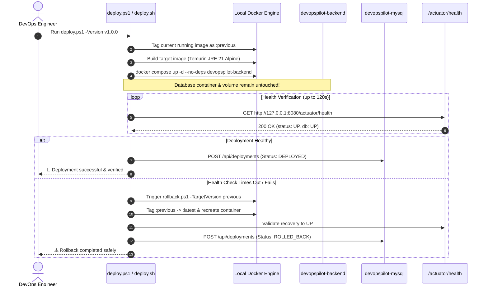

# DevOpsPilot 🚀
## Portfolio Guide, System Architecture & Technical Interview Cheatsheet

This document provides a comprehensive technical walkthrough of **DevOpsPilot**, designed for placement interviews, technical portfolio presentation, and deep-dive architectural discussions.

---

## 1. Project Overview & Problem Statement

### 🎯 Problem Statement
Most aspiring DevOps engineers and students face two significant hurdles when learning real-world delivery pipelines:
1. **Cloud Cost Barriers**: Practicing continuous delivery on AWS, GCP, or Azure quickly accumulates monthly bills (EC2, NAT Gateways, RDS, managed registries).
2. **Mocked / Superficial Projects**: Many portfolio projects rely on "mock data", simple bash echo scripts, or tutorials that stop after running a single container, failing to demonstrate real database migrations, health probes, automated failure recovery, or production-grade telemetry.

### 💡 Solution: DevOpsPilot
DevOpsPilot is a completely functional, self-hosted, end-to-end software delivery and infrastructure management platform built on a **₹0 budget**. It implements real production patterns:
- **Full-Stack Application**: Spring Boot 4 (Java 21) REST API with MySQL 8.0 persistence and a modern React JSX (Vite + Tailwind CSS) operations dashboard.
- **Automated CI/CD**: GitHub Actions workflow that executes automated unit tests, Flyway schema validation, production packaging, security linting, and multi-stage Docker image builds.
- **Zero-Cloud Safe Deployment & Automated Rollback**: Orchestrates container updates with zero data loss, evaluates Actuator readiness, and automatically restores previous working versions if startup health probes fail.
- **Production Observability**: Real-time JVM, system, and HTTP telemetry scraped by Prometheus and visualized in auto-provisioned Grafana dashboards.

---

## 2. End-to-End System Architecture

```mermaid
flowchart TD
    subgraph DeveloperWorkstation["Developer & CI/CD Layer"]
        DEV["Developer (VS Code / Git CLI)"]
        GHA["GitHub Actions CI/CD (.github/workflows/ci-cd.yml)"]
        TRIVY["Trivy Vulnerability Scanner"]
        DEV -->|git push| GHA
        GHA -->|mvn clean test| TEST["Java 21 Unit & Schema Tests"]
        GHA -->|npm run build| FE_BUILD["React JSX Production Bundle"]
        GHA -->|Container Scan| TRIVY
    end

    subgraph ContainerStack["Docker Multi-Container Orchestration (docker-compose)"]
        subgraph WebLayer["Presentation & Proxy Layer"]
            FE["devopspilot-frontend (Nginx Alpine)\n127.0.0.1:5173"]
        end

        subgraph AppLayer["Application Core"]
            BE["devopspilot-backend (Temurin JDK 21)\n127.0.0.1:8080"]
            ACT["Spring Boot Actuator\n/actuator/health & /prometheus"]
        end

        subgraph DataLayer["Persistence Layer"]
            DB[("devopspilot-mysql (MySQL 8.0)\n127.0.0.1:3307")]
            VOL[("Named Volume: devopspilot_mysql_data")]
            DB --- VOL
        end

        subgraph TelemetryLayer["Observability Stack"]
            PROM["devopspilot-prometheus (v2.53)\n127.0.0.1:9090"]
            GRAF["devopspilot-grafana (v11.1)\n127.0.0.1:3000"]
            PROM_VOL[("Volume: prometheus_data")]
            PROM --- PROM_VOL
        end
    end

    FE -->|Reverse Proxy /api/*| BE
    FE -->|Reverse Proxy /actuator/*| ACT
    BE -->|HikariCP JDBC Connection| DB
    PROM -->|Scrapes /actuator/prometheus (15s)| ACT
    GRAF -->|PromQL Data Source| PROM
```

---

## 3. End-to-End Delivery Workflow



---

## 4. Technical Challenges & Engineering Solutions

### Challenge 1: Safe Rollback Without Recreating Database Volumes
- **Problem**: Running naive `docker compose down` and `docker compose up` can drop database connections, interrupt active transactions, or accidentally wipe unmounted storage.
- **Solution**: Designed `deploy.ps1` and `rollback.ps1` using `docker compose up -d --no-deps devopspilot-backend devopspilot-frontend`. This target-specific deployment preserves the running MySQL 8 container and named volume (`devopspilot_mysql_data`), maintaining zero database downtime and 100% data persistence.

### Challenge 2: MySQL 8 Authentication & Port Conflicts on Windows
- **Problem**: Host machines often have a local MySQL or services bound to port `3306`, and MySQL 8 defaults to `caching_sha2_password` which rejects plain TCP handshakes without public key retrieval.
- **Solution**: Mapped the container to `127.0.0.1:3307:3306` in Docker Compose, isolated the bind strictly to the loopback adapter, and configured Spring Boot JDBC connection strings with `allowPublicKeyRetrieval=true` and `useSSL=false`.

### Challenge 3: Fast Cold-Start Health Polling
- **Problem**: Spring Boot on Alpine Linux with Flyway migration checks and JPA entity initialization takes 60–75 seconds on cold start under virtualization. A short health check timeout caused false-positive rollbacks.
- **Solution**: Adjusted the deployment polling window to 120 seconds with exponential interval sampling, checking both the top-level actuator `status: UP` and the underlying `components.db.status: UP`.

### Challenge 4: Zero-Touch Telemetry Provisioning
- **Problem**: Grafana typically requires manual UI login, data source creation, and dashboard importing on every fresh environment setup.
- **Solution**: Configured declarative Grafana provisioning (`devops/monitoring/grafana/provisioning/`) with an automated Prometheus data source and a custom JSON dashboard (`devopspilot-overview.json`) tracking CPU, memory heap, HTTP throughput, and uptime automatically upon container creation.

### Challenge 5: Secure Least-Privilege Containerization
- **Problem**: Default containers run as `root`, creating container breakout security risks.
- **Solution**: Hardened both Dockerfiles:
  - Backend: Added unprivileged user/group (`devopspilot`) in Alpine Temurin JRE 21.
  - Frontend: Used `nginxinc/nginx-unprivileged:alpine` listening on non-privileged port `8080`.

---

## 5. Resume Project Description (Suitable for Fresher / Junior DevOps Roles)
### Project Heading
**DevOpsPilot – End-to-End Automated Software Delivery & Infrastructure Management Platform**
*Technologies: Java 21, Spring Boot 4, React.js, Docker, Docker Compose, MySQL 8, GitHub Actions, Prometheus, Grafana, Trivy, PowerShell, Bash*

### Resume Bullet Points
- Architected and deployed a self-hosted software delivery platform on a ₹0 budget using Docker Compose, orchestrating a Spring Boot REST backend, React operations dashboard, MySQL, and Prometheus/Grafana observability.
- Built a multi-stage GitHub Actions CI/CD pipeline automating Maven testing, Node production bundling, Trivy container security scanning, and multi-stage Docker image builds.
- Implemented an automated deployment and self-healing rollback mechanism (`deploy.ps1`/`deploy.sh`) that tags previous Docker images, evaluates Spring Boot Actuator readiness, and executes zero-data-loss rollback upon failure.
- Configured declarative Prometheus scraping and Grafana dashboard provisioning to monitor real-time JVM heap memory, CPU usage, system uptime, and HTTP request metrics.
- Developed real-time REST audit APIs storing immutable deployment history and service registry metadata in MySQL with Flyway database migrations.

---

## 6. Interview Questions & Answers Cheatsheet

### Q1: Why did you choose Docker Compose over Kubernetes for this project?
> **Answer**: "For a ₹0 budget local development and staging setup, Kubernetes introduces significant resource overhead (control plane, kubelet, etcd, ingress controllers) that is unnecessary for a 5-container architecture. Docker Compose allows complete declarative orchestration, network isolation, and volume persistence with lightweight memory consumption (~1.5 GB RAM total)."

### Q2: How does your automated rollback mechanism work?
> **Answer**: "Before building or deploying a new container image, the deployment script tags the currently running container as `:previous`. It then deploys the new version using `docker compose up -d --no-deps <service>` so the database and monitoring services are not interrupted. The script polls `http://127.0.0.1:8080/actuator/health` and the frontend URL. If the service does not report `UP` within the timeout window (120s), the script automatically invokes `rollback.ps1`, which re-tags `:previous` back to `:latest`, restarts the container, validates health recovery, and records a `ROLLED_BACK` audit event into MySQL."

### Q3: How do you handle database migrations between versions?
> **Answer**: "We use Flyway integrated directly with Spring Boot. On startup, Flyway checks the `flyway_schema_history` table in MySQL and applies any pending versioned SQL migrations (e.g. `V1__initial_schema.sql`). This ensures database schemas evolve in code alongside the application."

### Q4: How is observability achieved without mock data?
> **Answer**: "We added `micrometer-registry-prometheus` to Spring Boot, which exposes live runtime metrics at `/actuator/prometheus`. Prometheus scrapes this endpoint every 15 seconds. Grafana is configured via auto-provisioning YAML files to mount Prometheus as a default datasource and automatically display our custom dashboard tracking real JVM garbage collection, heap utilization, HTTP response times, and container health."
